# Dify + Ollama + Scryer Prolog MCP: a working CLP(Z) example

This guide connects a local Scryer Prolog MCP server to a self-hosted Dify instance
running in Docker Desktop on macOS. It covers installation checks, the HTTP bridge,
authentication, the Docker-to-host connection, a narrowly scoped Squid exception,
and a complete tested workflow that executes integer constraints and explains the real result using a local Ollama model.

The workflow is **User Input → runPrologQuery → Code → LLM → Output**.
Scryer computes the solutions; Python serializes the tool response; the LLM explains it. No agent tool-selection loop is required.

The integration is general-purpose: use it for knowledge-base queries, logic
exercises, constraint solving, planning, or scheduling.

## Validation status

The following were observed during setup on November 3, 2026:

| Check | Result |
| --- | --- |
| Dify web interface | Accessible at `http://localhost` |
| Dify Docker images | API and web version `1.17.1` |
| Scryer version output | `cargo:0.10.0` |
| Native backend test | Passed on macOS |
| MCP stdio client/server test | Passed on macOS |
| Dependency audit after updating | Reported zero known vulnerabilities at that time |
| HTTP initialization through Supergateway | Returned HTTP 200 and MCP server metadata |
| Dify connection before proxy exception | Failed with Squid `TCP_DENIED/403` |
| Dify connection after proxy exception | Authorized; all four tools discovered |
| CLP(Z) execution from a Dify workflow | Passed; returned `[[1,2],[1,3],[2,3]]` |
| Code node receives the MCP JSON response | Passed after matching the input and Python parameter names |
| Local Ollama model receives the actual result | Passed with `llama3.2:latest` |
| Full five-node workflow | Completed successfully; final explanation generated in English |

The complete workflow was subsequently tested, in addition to tool discovery. The first generated explanation contained terminology errors; the improved prompt below addresses them. That revised prompt is a recommendation, not a separately verified screenshot result.
Audit results and third-party interfaces may change. Supergateway's exact package
version was not captured in the original session; the unpinned command below
reproduces the setup method rather than a fully locked environment.

## 1. Understand the components

| Component | Location | Responsibility |
| --- | --- | --- |
| Dify | Docker containers | Application UI, model orchestration, MCP client |
| Squid SSRF proxy | Dify Docker stack | Filters outbound requests |
| Supergateway | macOS terminal | Exposes the stdio server through Streamable HTTP |
| `index.mjs` | macOS repository | Registers the four MCP tools |
| Scryer executable | macOS | Executes Prolog and CLP(Z) |

Dify reaches the Mac at `host.docker.internal`. Inside a container, `localhost`
refers to that container, not the Mac. From a macOS terminal, use `localhost` to
reach the bridge. The bridge uses HTTP on port 8000; Dify's web UI uses port 80.

This guide concerns self-hosted Docker Desktop on macOS, not Dify Cloud or a
remote Linux deployment.

## 2. Prerequisites

- Docker Desktop installed and running.
- An existing self-hosted Dify installation and workspace login.
- Node.js 20 or later, npm, Git, and Python 3 for the optional proxy edit.
- Scryer Prolog installed and executable.
- This repository checked out locally.
- Ollama installed on the Mac, with `llama3.2:latest` available.
- The Ollama provider installed and configured in Dify. This workflow uses a regular LLM node, so model tool calling is not required.

Example checkout:

```bash
cd ~/Downloads
git clone https://github.com/jcarpio/scryer-prolog-mcp.git
cd scryer-prolog-mcp
```

If the folder already exists, enter that folder instead of cloning over it.
Find Scryer downloads and installation information at https://www.scryer.pl/.
Select the correct macOS architecture (Apple Silicon or Intel).

## 3. Confirm Dify is running

Open Docker Desktop, then run:

```bash
docker ps -a --format "table {{.Names}}\t{{.Image}}\t{{.Status}}\t{{.Ports}}"
```

In the validated installation, relevant containers included:

- `docker-api-1` and `docker-web-1`: Dify `1.17.1`.
- `docker-nginx-1`: published host ports 80 and 443.
- `docker-ssrf_proxy-1`: outbound Squid proxy.
- Worker, database, Redis, plugin daemon, and sandbox containers.

Container names depend on the Compose project name. Substitute your actual names
in subsequent commands. Brief `health: starting` states can occur during startup.
A one-shot initialization container with `Exited (0)` has completed successfully.

Open http://localhost and sign in. If port mappings differ, use the published port
shown by `docker ps`. This guide does not reinstall Dify or modify its database.

## 4. Install and test the MCP server locally

```bash
cd ~/Downloads/scryer-prolog-mcp
npm ci
scryer-prolog --version
npm test
```

Use `npm install` if your copy has no lockfile. Expected test output:

```text
PASS: CLP(Z), bindings, failure, exceptions, sessions, path validation, timeout
PASS: MCP stdio initialize, listTools, loadProgram, CLP(Z) query
```

If Scryer is not on PATH, set its absolute executable path in the same terminal:

```bash
export SCRYER_PROLOG="/absolute/path/to/scryer-prolog"
npm test
```

Find an executable already on PATH with:

```bash
command -v node
command -v scryer-prolog
```

Supergateway and its child MCP process inherit this environment. Scryer runs on
the Mac; it does not need to be installed in the Dify container.

### Dependency audit performed during setup

The initial prototype used SDK `1.0.1`. Updating to `1.32.2` and refreshing the
compatible transitive dependency resolved the findings reported in that session:

```bash
npm install --save-exact @modelcontextprotocol/sdk@1.32.2
npm audit fix
npm audit
npm test
```

The repository may already contain these updates; do not repeat them unnecessarily.
Inspect current advisories before future upgrades. A zero audit count only means
no known findings were reported by that audit; it is not a security certification.
Commit both `package.json` and `package-lock.json` after intentional updates.

## 5. Start the Streamable HTTP bridge

The repository's server speaks stdio. Dify needs an HTTP endpoint, so use
[Supergateway](https://github.com/supercorp-ai/supergateway) as a bridge.

Run the following in a dedicated macOS terminal. It works with the default example
checkout path and handles spaces in the repository path:

```bash
cd ~/Downloads/scryer-prolog-mcp

npx -y supergateway \
  --stdio "node \"$PWD/index.mjs\"" \
  --outputTransport streamableHttp \
  --stateful \
  --sessionTimeout 3600000 \
  --port 8000 \
  --apiKey "scryer-local-test"
```

Keep this terminal open. The key above is a deliberately public, disposable demo
value. For any shared environment, choose a fresh private key and use the same
value in Dify. Do not commit real keys to Git.

| Option | Purpose |
| --- | --- |
| `--stdio` | Starts this repository's MCP entry point |
| `--outputTransport streamableHttp` | Provides HTTP MCP at `/mcp` |
| `--stateful` | Enables stateful HTTP transport sessions |
| `--sessionTimeout 3600000` | Sets the bridge session timeout to one hour |
| `--port 8000` | Chooses the host TCP port |
| `--apiKey` | Requires a key on incoming MCP requests |

The one-hour bridge session timeout does not change the engine's 15-second query
execution limit. Stateful transport also does not preserve a Scryer process:
each Prolog query still starts a fresh native process.

The bridge must be reachable from Docker, so do not restrict it to a loopback-only
listener unless you have verified Docker can reach that binding. Its default
listener may also be reachable from your LAN. This is a local trusted-code demo:
do not forward port 8000 to the Internet. Use appropriate firewall restrictions,
private credentials, TLS, and process isolation for any wider deployment.

For repeatability, record the installed gateway version and use
`npx -y supergateway@<recorded-version>` in future runs.

## 6. Verify the HTTP endpoint from macOS

In a second terminal, execute:

```bash
curl -i --max-time 10 \
  http://localhost:8000/mcp \
  -H 'Authorization: Bearer scryer-local-test' \
  -H 'Content-Type: application/json' \
  -H 'Accept: application/json, text/event-stream' \
  --data '{"jsonrpc":"2.0","id":1,"method":"initialize","params":{"protocolVersion":"2025-03-26","capabilities":{},"clientInfo":{"name":"diagnostic","version":"1.0"}}}'
```

The observed response was HTTP `200 OK`, content type `text/event-stream`, a
session ID header, and an initialization result containing:

```json
{
  "protocolVersion": "2025-03-26",
  "capabilities": {"tools": {}},
  "serverInfo": {"name": "scryer-prolog-mcp", "version": "0.1.0"}
}
```

Session IDs vary. This command checks initialization only. Do not reuse its session
ID as a Dify configuration value. A timeout after receiving a valid event can mean
the HTTP event stream stayed open; inspect the response before treating it as a
connection failure. For protocol follow-up requests, clients manage initialization
notifications and session headers themselves.

## 7. Register the server in Dify

Navigate to **Integrations → Tools → MCP → Add MCP Server (HTTP)**.
In the Spanish UI used during setup, these appeared as **Integraciones →
Herramientas → MCP → Añadir servidor MCP (HTTP)**.

| Field | Value |
| --- | --- |
| Server URL | `http://host.docker.internal:8000/mcp` |
| Name | `Scryer Prolog` |
| Server identifier | `scryer-prolog` |
| Header name | `Authorization` |
| Header value | `Bearer scryer-local-test` |

Add the header under **Headers / Encabezados**. This bridge uses bearer-key
validation, not OAuth: leave Client ID and Client Secret empty. The dynamic client
registration toggle was left at its default in the observed UI; no OAuth credentials
were required for the successful connection.

Click **Add and Authorize / Añadir y Autorizar**. If it fails with HTTP 403,
continue with the proxy diagnosis below. Once fixed, retry authorization on the
existing entry rather than creating duplicates.

Successful registration shows **Authorized / Autorizado** and these four tools:

| Tool | Function |
| --- | --- |
| `loadProgram` | Validate and replace the current source program |
| `runPrologQuery` | Execute a query and return its first solution |
| `saveSession` | Save source under a simple filename |
| `loadSession` | Validate and restore saved source |

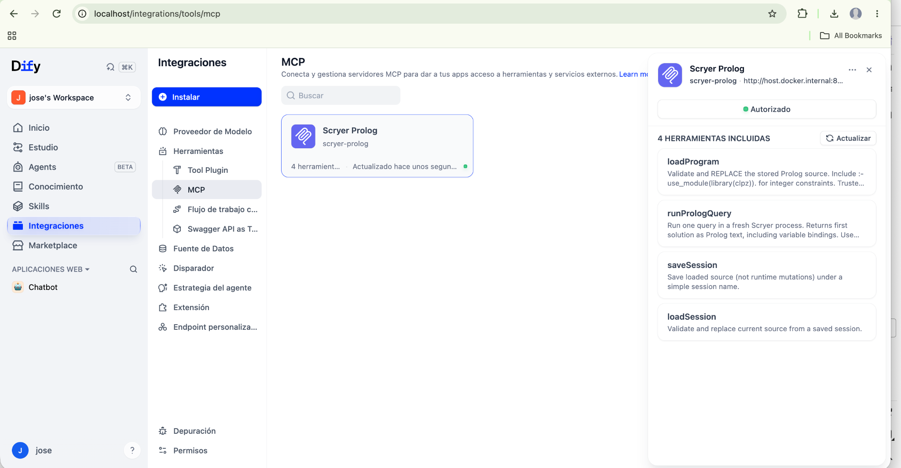

*The initial connection screenshots use the Spanish interface. The workflow screenshots below use English.*

## 8. Diagnose HTTP 403 before changing configuration

A working host-side curl request does not prove that Docker's outbound proxy
permits the same destination. During setup, Dify returned HTTP 403 and the proxy
logged:

```text
TCP_DENIED/403 ... POST http://host.docker.internal:8000/mcp ... HIER_NONE/-
```

This identified Squid as the rejecting component. The MCP itself had already
returned HTTP 200 to the host-side initialization request.

Inspect the logs and effective configuration:

```bash
docker logs --tail 40 docker-ssrf_proxy-1

docker exec docker-ssrf_proxy-1 sh -c \
  'cat /etc/squid/squid.conf'

docker exec docker-ssrf_proxy-1 sh -c \
  'cat /etc/squid/dify_common.conf; cat /etc/squid/dify_allow_private.conf'

docker inspect docker-ssrf_proxy-1 \
  --format '{{range .Mounts}}{{println .Source " -> " .Destination}}{{end}}'
```

The observed common configuration already allowed ports `1025-65535` through
`Safe_ports`, which includes 8000. The private-destination deny rule blocked the
Mac's Docker address. The generated private allowlist contained comments only.

The relevant effective rule order was:

```conf
include /etc/squid/dify_common.conf
acl allowed_domains dstdomain .marketplace.dify.ai
http_port 3128
http_access deny !Safe_ports
http_access deny CONNECT !SSL_ports
http_access allow localhost manager
http_access deny manager
include /etc/squid/dify_sandbox_proxy.conf
include /etc/squid/dify_allow_private.conf
http_access deny to_private_networks
http_access allow allowed_domains
http_access allow client_localnet
http_access allow localhost
http_access deny all
```

Squid evaluates access rules in order. An allow rule below the private-network
deny would not fix this denial.

## 9. Add a narrowly scoped persistent proxy exception

Apply this only if your logs and configuration match the diagnosis above.
If a future Dify version provides a supported private-target allowlist setting,
prefer that documented mechanism. The procedure below records the template-based
fix actually used in this installation.

The mounted template was located at:

```text
/Users/jose/dify/dify/docker/ssrf_proxy/squid.conf.template
```

Discover your actual path using `docker inspect`; do not assume the username or
Dify checkout location. Modify the mounted template, not only the generated
`/etc/squid/squid.conf`, which can be regenerated on startup.

Insert the following immediately before `http_access deny to_private_networks`:

```conf
acl scryer_host dstdomain host.docker.internal
acl scryer_port port 8000
http_access allow client_localnet scryer_host scryer_port
```

This authorizes requests from the existing client-local-network ACL to the named
host on port 8000. It leaves the other deny rules intact. It is a host/port
exception, not a URL-path or per-user restriction. Authentication remains the
bridge's responsibility.

### Back up and edit the template

The script below refuses to edit an unexpected rule layout. Adjust the path first.
If it reports that the ACL exists, inspect it rather than assuming it is correct.

```bash
python3 <<'PY'
from pathlib import Path
from datetime import datetime

p = Path('/Users/jose/dify/dify/docker/ssrf_proxy/squid.conf.template')
text = p.read_text()
rule = '''acl scryer_host dstdomain host.docker.internal
acl scryer_port port 8000
http_access allow client_localnet scryer_host scryer_port

'''
anchor = 'http_access deny to_private_networks'

if 'acl scryer_host ' in text:
    print('The exception already exists; inspect its content and position.')
else:
    if text.count(anchor) != 1:
        raise SystemExit('No change: expected exactly one private-network deny rule.')
    backup = p.with_name(p.name + '.bak-' + datetime.now().strftime('%Y%m%d-%H%M%S'))
    backup.write_text(text)
    p.write_text(text.replace(anchor, rule + anchor))
    print('Exception added. Backup:', backup)
PY
```

Restart only the affected proxy:

```bash
docker restart docker-ssrf_proxy-1
```

Wait for startup, then inspect the effective configuration and logs:

```bash
docker exec docker-ssrf_proxy-1 cat /etc/squid/squid.conf
docker exec docker-ssrf_proxy-1 squid -k parse
docker logs --tail 20 docker-ssrf_proxy-1
```

The original setup succeeded after restarting this proxy and retrying authorization
in Dify. Dify also had an `agent_ssrf_proxy` service; it was not changed in that
validated registration flow. If a later agent execution takes a different network
path, inspect that proxy's own logs and mounts before applying any exception there.

### Roll back

Restore the exact backup path printed by the edit script, then restart the proxy:

```bash
cp /absolute/path/to/squid.conf.template.bak-TIMESTAMP \
   /absolute/path/to/squid.conf.template
docker restart docker-ssrf_proxy-1
```

Restoring an old backup also restores its other settings. Review the difference
first if the template has changed since the backup. Keep environment-specific
proxy configuration outside this MCP repository.

## 10. Configure local Ollama

On the Mac, check available models:

```bash
ollama list
```

The tested model was `llama3.2:latest`. If it is not installed:

```bash
ollama pull llama3.2:latest
```

Keep Ollama running. In **Integrations → Model Provider**, install the Ollama provider if necessary, then add or configure the model:

| Setting | Value |
| --- | --- |
| Base URL | `http://host.docker.internal:11434` |
| Model name | `llama3.2:latest` |
| Model type | LLM / Chat |

Use the provider's Ollama base URL, without appending `/api` or `/v1`. The model configuration used an already configured credential entry. A local default Ollama installation does not normally require an API key; the UI's credential label alone does not imply a paid API.

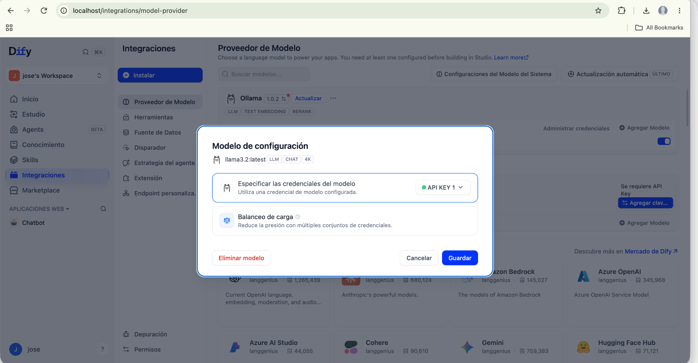

If the model cannot connect, verify Ollama's listener and Docker-to-host access. If a proxy returns 403, inspect its logs for port 11434 before changing rules. The port-8000 exception above does not cover Ollama. No additional Ollama proxy exception was needed in the observed run.

## 11. Create the workflow

Open **Studio → Create from scratch** and choose **Workflow**. Name it:

```text
Scryer MCP Connection Test
```

Choose **User Input** as the start node. No custom input fields are required: this first example uses a fixed query.

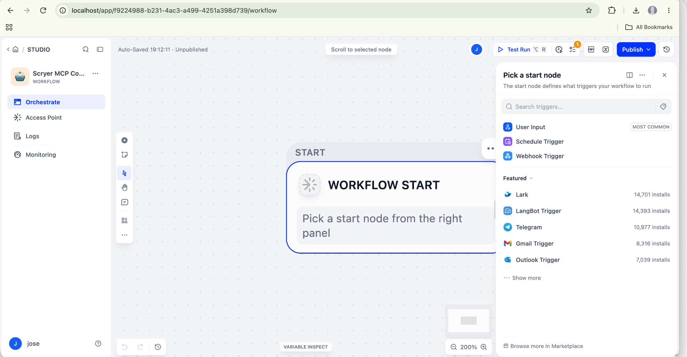

Build the following sequence using each node's **+** or **Select Next Step** control:

| Order | Node | Purpose |
| --- | --- | --- |
| 1 | User Input | Starts the test manually |
| 2 | Scryer Prolog → runPrologQuery | Executes the fixed CLP(Z) query |
| 3 | Code, Python 3 | Converts the JSON response into a string |
| 4 | LLM, Ollama | Explains the real tool output in English |
| 5 | Output | Returns the explanation |

When selecting a tool, open **Tools → MCP → Scryer Prolog → runPrologQuery**. The final node is named **Output** in the tested interface. Other Dify versions may use different labels.

## 12. Configure runPrologQuery

In **Settings → Input Variables**, paste the following directly into **query** as a constant. Do not wrap it in JSON, add `?-`, or insert an agent `action` envelope.

```prolog
use_module(library(clpz)),
read_term_from_chars(
    "findall([X,Y], (X in 1..3, Y in 1..3, X #< Y, labeling([], [X,Y])), Pairs).",
    Goal,
    [variable_names(Names)]
),
call(Goal),
write_term(Names, [quoted(true)]),
nl.
```

Set **template** to the string:

```text
true
```

This is a Prolog term supplied through a string field, not a JSON boolean. Leave retry disabled for this first test.

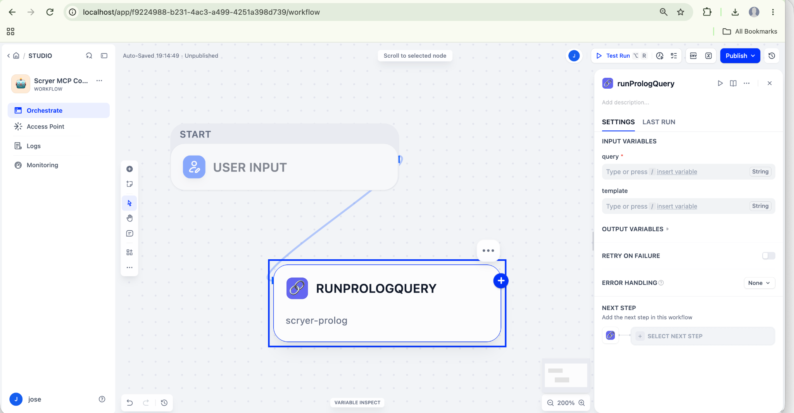

### Why this query works without loadProgram

This example deliberately performs all computation in one tool call. It does not rely on source loaded by a previous call or on transport-session reuse.

1. `use_module(library(clpz))` imports integer constraints.
2. `read_term_from_chars/3` parses the quoted constraint goal after the import, when operators such as `in` and `#<` are available. The engine already imports `library(charsio)` internally.
3. `X in 1..3` and `Y in 1..3` constrain both variables to integers 1, 2, or 3.
4. `X #< Y` requires the first integer to be strictly smaller.
5. `labeling([], [X,Y])` enumerates concrete assignments.
6. `findall/3` collects every pair in `Pairs`.
7. `write_term/2` prints the named bindings to stdout.

The expected solution list is:

```prolog
[[1,2], [1,3], [2,3]]
```

### Test the tool node first

Use the small run button in the query node panel. Inspect **Last Run**. The observed response had `status: "success"`, empty `stderr`, and stdout containing:

```text
['X'=_595872,'Y'=_595877,'Pairs'=[[1,2],[1,3],[2,3]]]
```

Internal identifiers such as `_595872` vary. X and Y remain unbound outside the collected goal because `findall/3` collects its solutions without binding those outer variables. The ground list in `Pairs` is the relevant answer.

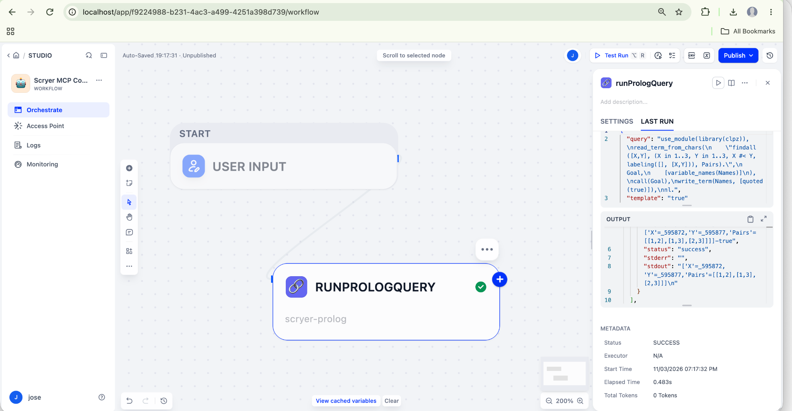

**Important:** in this Dify integration, the tool's JSON-formatted text content was parsed into the **json** output, while **text** was an empty string. Passing `runPrologQuery → text` to the LLM therefore sent no result.

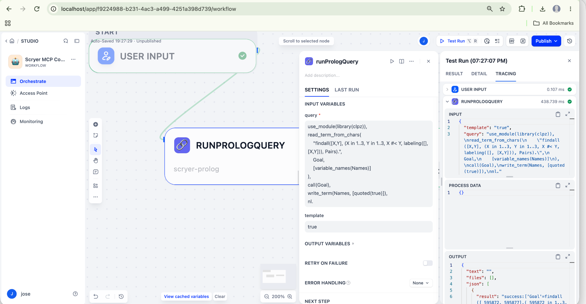

## 13. Configure the Code node

Add **Code** after the query node. Select **Python 3**.

Configure exactly one input variable:

| Input name | Value selected using Dify's variable picker |
| --- | --- |
| `result` | `runPrologQuery → json` |

Delete unused default inputs such as `arg1` and `arg2`. `result` is the name of the Code node input; it is separate from each object's own `result` property inside the array.

Paste this code:

```python
import json


def main(result: list) -> dict:
    return {
        "tool_output": json.dumps(result, ensure_ascii=False)
    }
```

Under **Output Variables**, configure:

| Name | Type |
| --- | --- |
| `tool_output` | String |

The input variable must be named **result**, exactly matching `main(result: list)`. Using `results`, `arg1`, or an extra input causes an unexpected-keyword error unless the function signature is changed to match.

Test the node. Its input should contain the actual response array, not `null`, and its output should contain a nonempty `tool_output` string. The code only serializes existing data: it does not solve the problem or fabricate results.

If the variable picker does not initially list `json`, expand the query node's **Output Variables**, check that the tool has completed a successful run, and inspect the available output schema. Do not silently select empty `text` as a substitute.

## 14. Configure the LLM node

Add an **LLM** node after Code. Select the configured Ollama model **llama3.2:latest**. Leave vision disabled; this example contains no images as model inputs.

Use this **SYSTEM** message:

```text
Explain the actual Scryer Prolog tool output in clear, concise English.

Report whether execution succeeded.
List the pairs returned.
Explain that X and Y are integers from 1 to 3 and X must be strictly less than Y.
Explain that labeling/2 enumerates concrete integer assignments and findall/3 collects all solutions.

Goal, Names, and Pairs are variable names, not atoms describing separate results.
Identifiers such as _595872 are internal variable names; omit them from your explanation.
Do not describe the two-element pair structure as an additional constraint.

If execution failed, report the actual error.
Do not invent results or claim that you executed the query yourself.
```

This prompt is specific to the fixed example. Update it when changing the query rather than retaining the 1-to-3 description for a different problem.

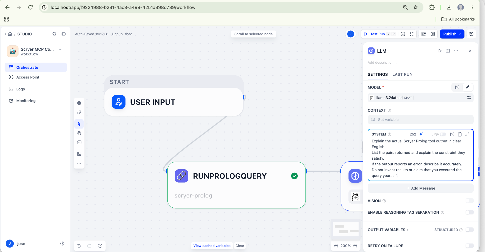

Click **Add Message**, choose **USER**, and enter:

```text
Explain this actual Scryer Prolog tool output:

```

Below that text, insert **Code → tool_output** using the variable picker (`/` or the variable control). Select the actual variable token; typing a descriptive label such as `Code → tool_output` as ordinary text does not bind the value.

Do not select `runPrologQuery → text`: that field was empty in this test.

The earlier screenshot below shows how to open the variable picker, before the Code node was added. For the completed workflow, select **Code → tool_output**, not the old query-node text field shown in that screenshot.

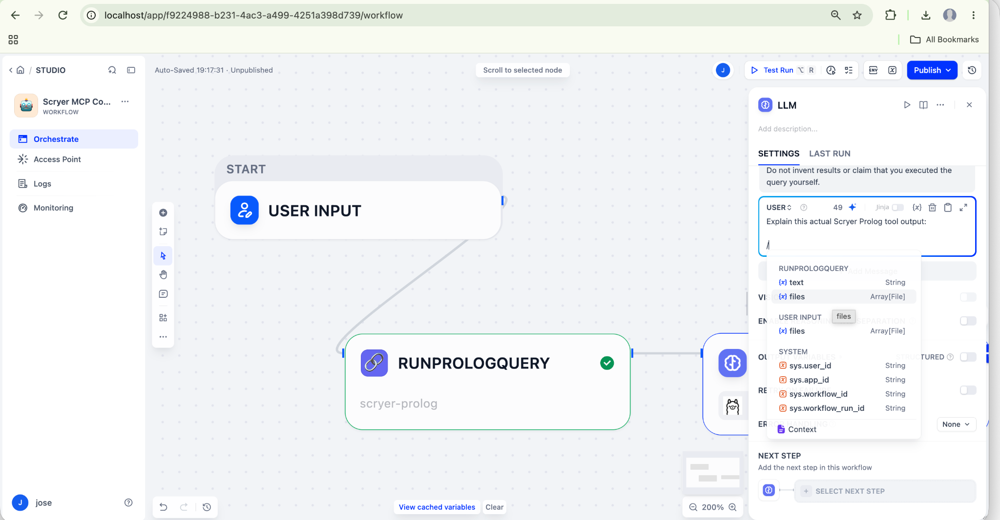

The LLM's resolved prompt must include the response after the heading. Inspect **Tracing → LLM** after a full run to verify it. If the prompt ends immediately after the heading, the data binding is still missing.

## 15. Configure Output and run the complete example

Add **Output** after LLM. Define:

| Output variable name | Selected value |
| --- | --- |
| `explanation` | `LLM → text` |

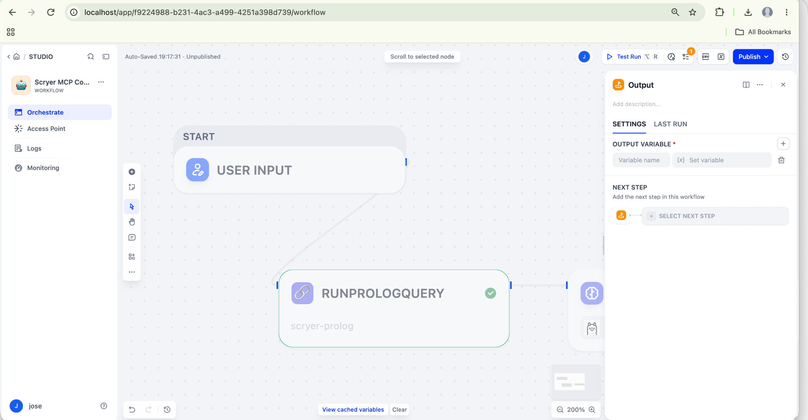

Check that the connections form one continuous path through all five nodes. Click **Test Run** at the top, then run the workflow. No input values are required for this fixed example. Publishing is not required for an editor test.

Success means:

- All five nodes complete successfully in the current run's trace.
- The query node returns `status: "success"` and the three pairs.
- Code outputs a nonempty `tool_output` string.
- The LLM receives that string in its USER prompt.
- Output returns an English explanation.

A representative concise explanation is:

```text
The query executed successfully and returned three pairs:
[1,2], [1,3], and [2,3].

These are all pairs of integers X and Y between 1 and 3
for which X is strictly less than Y.

labeling/2 enumerates the concrete assignments, and
findall/3 collects all solutions. No errors were reported.
```

The exact wording is model-generated and may vary. The Prolog answer must remain the same.

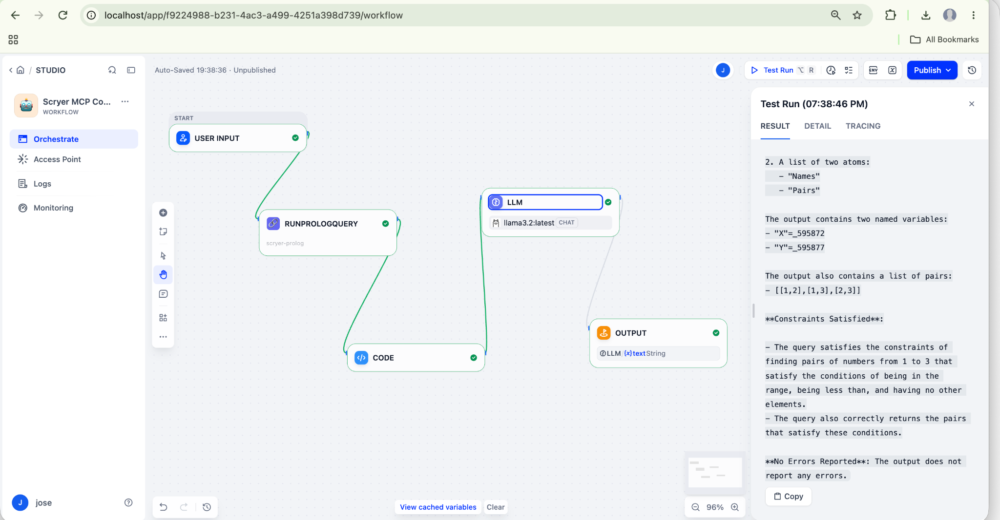

*This screenshot records the successful run with the earlier system prompt. Its explanation correctly lists the pairs but incorrectly describes some variable names as atoms. The refined SYSTEM prompt above was proposed afterwards to improve terminology; the screenshot does not demonstrate that revised prompt.*

## 16. Troubleshoot the workflow data flow

| Symptom | Cause observed or check to perform | Fix |
| --- | --- | --- |
| LLM asks for the missing output | The USER prompt contains only the heading | Insert Code → tool_output and inspect the resolved prompt |
| Query succeeds but `text` is empty | Dify put the parsed response in `json` | Bind Code's input to runPrologQuery → json |
| `main() got an unexpected keyword argument 'arg1'` | Default input name does not match the Python parameter | Delete defaults; use input `result` and `main(result: list)` |
| `unexpected keyword argument 'result'; did you mean 'results'?` | Singular/plural mismatch | Use `result` consistently in the input name and code |
| Code input is `null` | Input has no selected upstream value | Select the real query-node json output |
| Output variable missing | Returned dictionary key and declared output differ | Declare `tool_output` as String and return that exact key |
| Green tool node but inaccurate explanation | Model interpretation error | Check raw JSON, use the refined prompt, and compare all three pairs |
| Old error still appears | Viewing a previous test's trace | Run a fresh Test Run after saving settings |

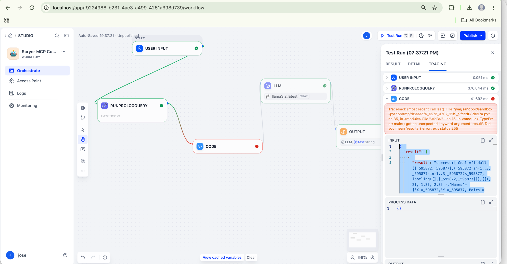

### Why the legacy ReAct agent was not used for the working example

The initial legacy-agent experiment sometimes printed simulated observations, supplied a plain string instead of an argument object, or repeatedly reloaded source. A displayed action in a model response is not proof of a tool invocation.

The working workflow calls the MCP tool directly with configured fields. Ollama only explains the returned data, so success does not depend on the model producing a valid ReAct action envelope.

For a future agent experiment, tool arguments must be objects such as `{"query":"..."}` or `{"program":"..."}`. The MCP's `loadProgram` field is **program**. Source that appears missing between tool calls warrants inspecting the actual load arguments and transport-session reuse; this session did not establish a definitive root cause for every legacy-agent failure.

## 17. Source state, transport sessions, and limits

- `loadProgram` replaces source; it does not append to it.
- The MCP process stores that source in memory between calls to that process.
- Every query starts a fresh Scryer process and reloads the stored source.
- `assertz/1`, `retract/1`, and residual constraints do not persist between queries.
- `saveSession` persists source, not a live Prolog heap. Session files can be
  overwritten when the same name is reused.
- Transport session reuse is a separate concern: two Dify tool calls must reach
  the same MCP source state, or explicitly restore source.
- To make query nodes independent, `loadSession/filename` followed by a query can
  also encounter transport separation. A future atomic source-plus-query tool is
  a clearer solution for independent workflow calls.
- The engine returns the first solution of the outer query. Use `findall/3` for
  small, bounded collections of ground answers.
- Query timeout is 15 seconds; output limit is 1 MiB.
- `timeout` does not prove that constraints have no solution.
- The prototype is for trusted local code, not a multiuser execution sandbox.

Do not promise cross-user isolation or persistent runtime state from the HTTP
bridge. Use separate project processes and a deliberate storage model before
building a shared service.

## 18. Connection troubleshooting

| Symptom | Check or action |
| --- | --- |
| Docker daemon unavailable | Start Docker Desktop and wait for it to finish |
| Dify page unavailable | Check Nginx status and published host port |
| `scryer-prolog` not found | Set SCRYER_PROLOG to the executable's absolute path before starting the bridge |
| Port 8000 already in use | Inspect with `lsof -nP -iTCP:8000 -sTCP:LISTEN`; do not stop an unidentified service |
| HTTP 401 | Check the gateway key and Dify Authorization header match |
| HTTP 403 with `TCP_DENIED` in Squid | Inspect proxy rule order and the destination/port exception |
| HTTP 403 without a Squid denial | Inspect bridge logs and response body; host validation may be a different cause |
| Connection refused | Check the bridge is running, the port is correct, and its listener is reachable from Docker |
| Dify uses `localhost:8000` | Change it to `host.docker.internal:8000` for Docker Desktop on macOS |
| Authorization succeeds, application fails | Inspect the application trace, tool arguments, session behavior, and relevant proxy logs |
| Source disappears between calls | Check MCP session reuse; use the single-call diagnostic above |
| Query times out | Try a smaller finite domain or improve search; do not report unsatisfiable |
| Constraints are syntactically rejected | Import CLP(Z) before parsing expressions that use its operators |
| Gateway restarted | Reauthorize or reconnect the Dify integration; previous in-memory source may be gone |

Useful diagnostics:

```bash
docker logs --tail 40 docker-ssrf_proxy-1
docker logs --tail 40 docker-api-1
lsof -nP -iTCP:8000 -sTCP:LISTEN
```

Inspect gateway output in its terminal. Redact credentials before sharing logs.
Do not disable the entire SSRF proxy or allow all private destinations to resolve
one host/port connection problem.

## 19. Stop and resume

Stop the bridge with Ctrl+C in its terminal. This does not stop Dify or delete saved
source files. To resume, start the bridge again, check the integration, and reload
any required program. The template exception remains until removed or overwritten
by a Dify configuration update; recheck it after upgrades.

For a temporary demonstration, remove the three Scryer-specific ACL lines or
restore the reviewed backup when access is no longer needed, then restart the proxy.

## 20. Save this example in Git

Copy the supplied `examples/dify` directory into your repository root, keeping the screenshot directory alongside README.md. This is a documentation-only update; it does not change the MCP implementation.

```text
examples/dify/
  README.md
  screenshots/
    02-mcp-authorized.png
    ...
```

Review and commit the guide and images together:

```bash
git diff -- examples/dify/README.md
git status --short -- examples/dify/
git add examples/dify/
git commit -m "Document local Dify integration with Scryer Prolog MCP"
git push
```

For a new untracked file, `git diff --no-index /dev/null examples/dify/README.md`
can show its content before staging (exit status 1 simply indicates a difference).

## References

- [Scryer Prolog MCP repository](https://github.com/jcarpio/scryer-prolog-mcp)
- [Scryer Prolog documentation](https://www.scryer.pl/)
- [Supergateway options and transport examples](https://github.com/supercorp-ai/supergateway)
- [Dify documentation](https://docs.dify.ai/)
- [Docker Desktop networking](https://docs.docker.com/desktop/features/networking/)
- [Squid http_access reference](https://www.squid-cache.org/Doc/config/http_access/)
